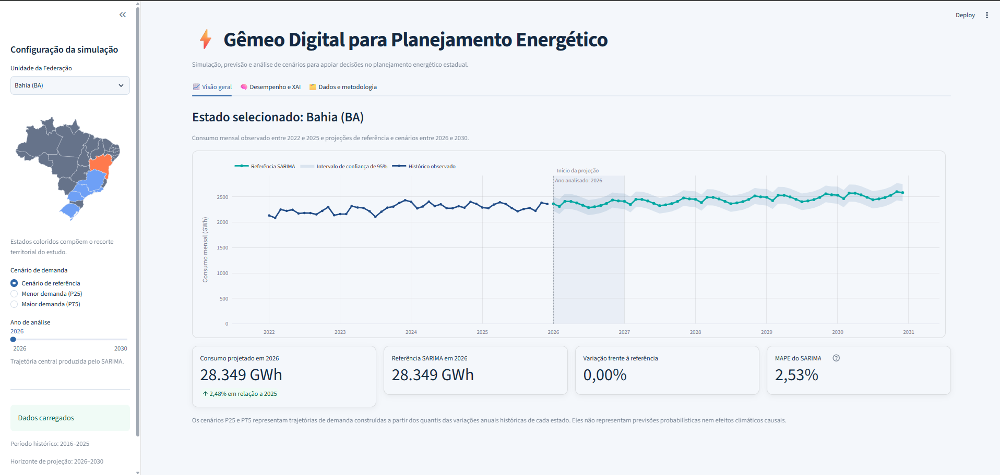
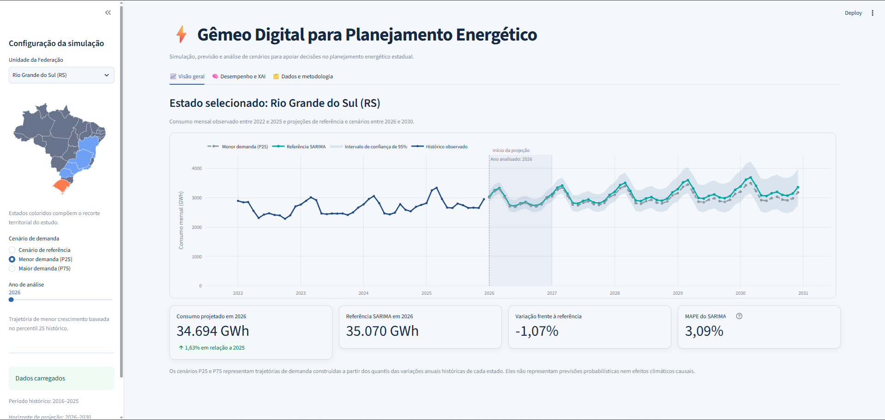
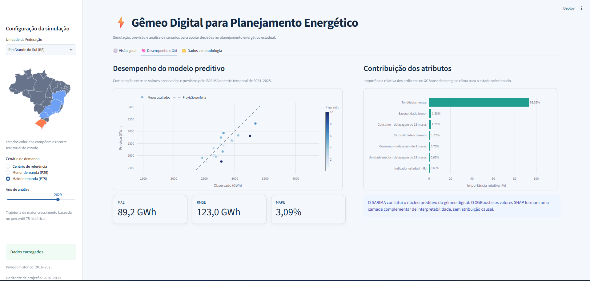
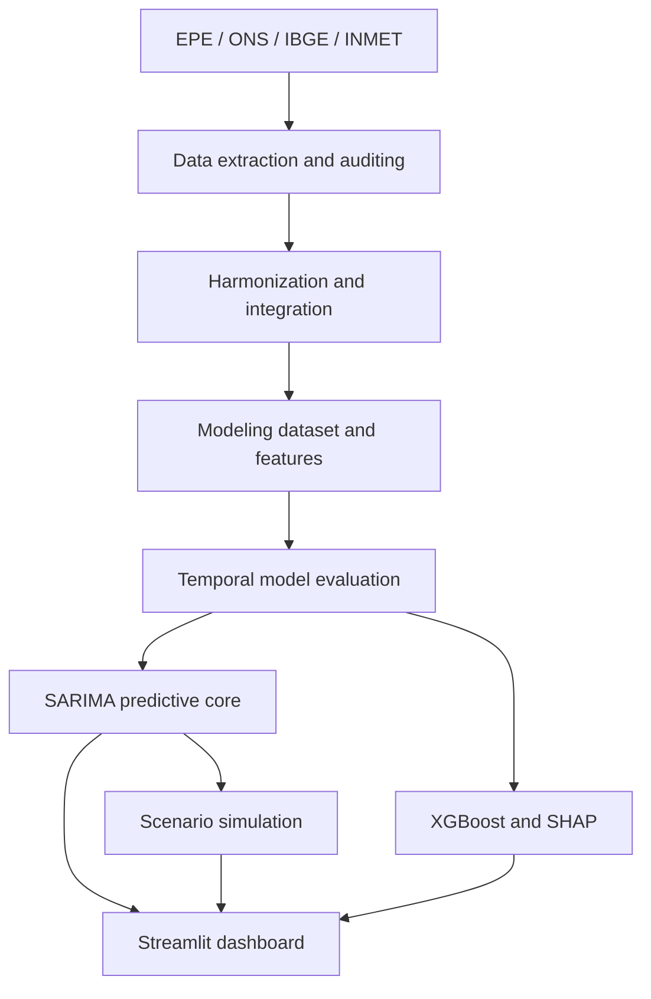
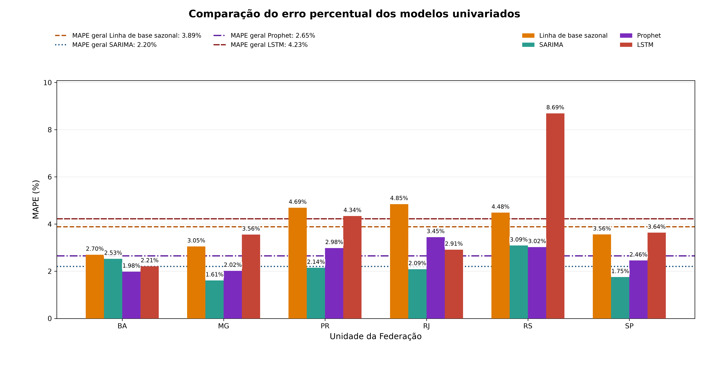
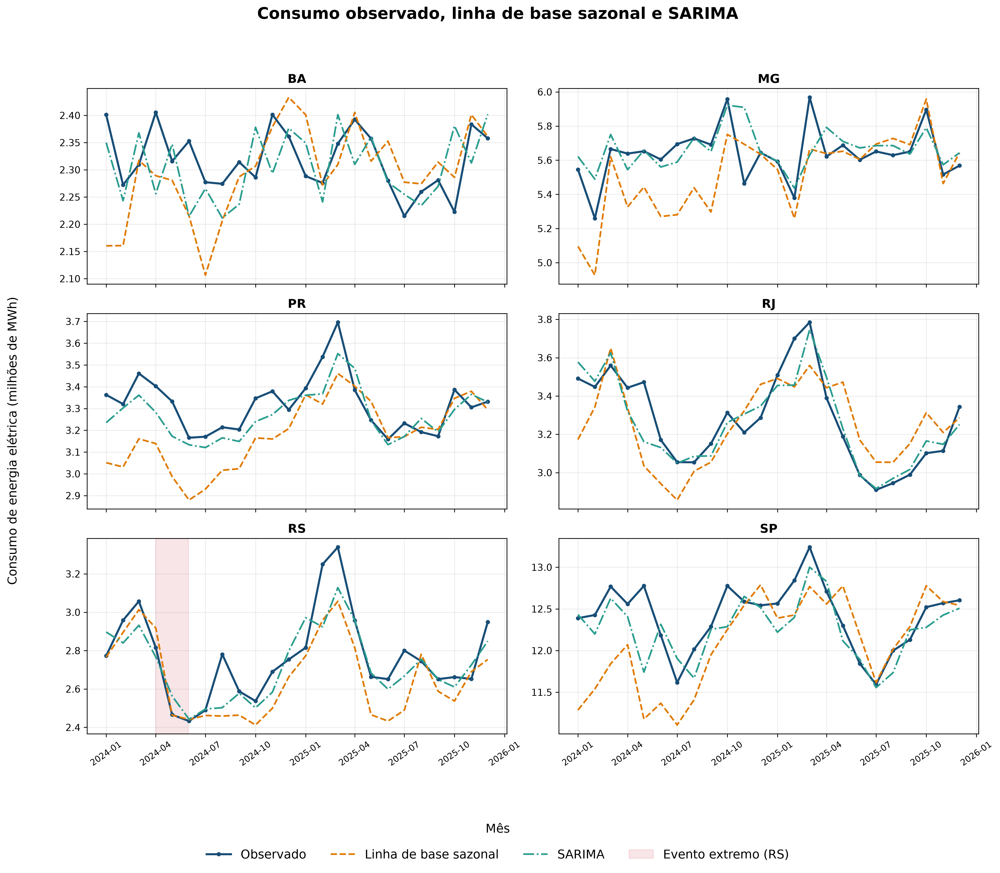
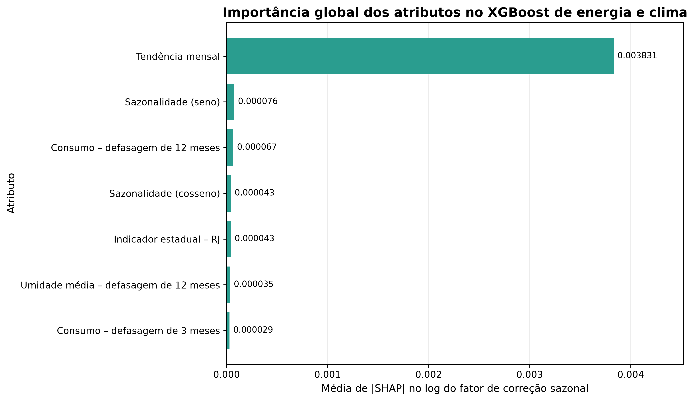
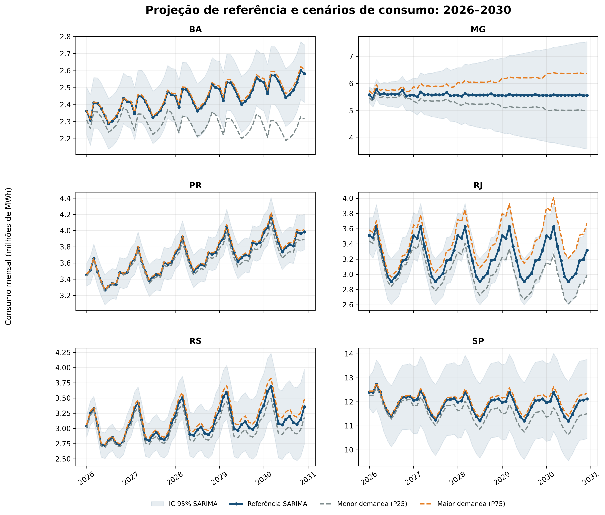

# Energy Planning Digital Twin

**Electricity consumption forecasting and scenario analysis for Brazilian states.**

[Português (Brasil)](README.pt-BR.md)

  

Energy planning requires more than accurate forecasts. It also requires understanding regional consumption patterns, evaluating alternative demand trajectories and recognizing the limitations of predictive models.

This project integrates public energy, socioeconomic and climate data into a computational framework for six Brazilian states. It combines time-series forecasting, machine learning, explainable AI and an interactive dashboard to support electricity consumption analysis through 2030.

Rather than assuming that more complex algorithms would deliver better predictions, the study compared five modeling approaches. SARIMA achieved the lowest overall forecasting error and was adopted as the predictive core of the digital twin.

## Key results

| Indicator | Result |
|---|---:|
| Brazilian states | 6 |
| Public data sources | 4 |
| Forecasting approaches | 5 |
| Evaluation observations | 144 |
| SARIMA overall MAPE | **2.20%** |
| Relative MAPE reduction against seasonal baseline | **43.4%** |
| Projection horizon | 2026–2030 |

## Dashboard



The Streamlit application allows users to select a state, demand scenario and year of analysis. It displays historical consumption, monthly projections, the SARIMA 95% interval and annual indicators.

The interface also provides model performance metrics, feature importance, data provenance, methodological assumptions and options to export monthly and annual results.

| Scenario analysis | Model performance and XAI |
|---|---|
|  |  |

Additional views: [higher demand](docs/screenshots/03_higher_demand_scenario.png) · [year selection](docs/screenshots/04_interactive_time_horizon.png) · [data and methodology](docs/screenshots/06_data_and_methodology.png) · [dark mode](docs/screenshots/07_dark_mode.png).

The current dashboard interface is in Brazilian Portuguese.

## Research scope and data

The study covers Bahia (BA), Minas Gerais (MG), Paraná (PR), Rio de Janeiro (RJ), Rio Grande do Sul (RS) and São Paulo (SP). This geographic scope captures distinct regional consumption patterns and includes Rio Grande do Sul, where the extreme weather events of 2024 provide relevant context for examining energy consumption variability.

| Source | Information |
|---|---|
| EPE — Energy Research Office | Monthly electricity consumption |
| ONS — National Electric System Operator | Electricity load |
| IBGE — Brazilian Institute of Geography and Statistics | Population and state GDP |
| INMET — National Institute of Meteorology | Climate indicators |

Electricity consumption is the forecasting target. ONS load and EPE consumption are distinct quantities and must not be treated as interchangeable.

The data preparation process includes source auditing, temporal harmonization, geographic aggregation, integration and feature engineering. The integrated historical dataset covers 2015–2025; the feature-based modeling dataset covers 2016–2025. Source-specific coverage and missing observations must be considered when interpreting the integrated data.

See the [energy data dictionary](docs/dicionario_base_energetica.md) and [processed datasets](data/processed/) for additional documentation and audit outputs.

## Architecture



The architecture separates data preparation, predictive modeling, scenario simulation and interpretation. The dashboard consumes the resulting analytical artifacts rather than retraining all models during interaction.

## Forecasting performance

The models were evaluated over 2024–2025, with 24 monthly observations per state. MAE and RMSE are reported in MWh; MAPE is expressed as a percentage.

| Model | MAE (MWh) | RMSE (MWh) | MAPE |
|---|---:|---:|---:|
| Seasonal baseline | 186,860 | 288,806 | 3.89% |
| **SARIMA** | **100,095** | **158,282** | **2.20%** |
| Prophet | 126,373 | 182,909 | 2.65% |
| LSTM | 199,584 | 280,206 | 4.23% |
| XGBoost — historical | 174,875 | 257,884 | 3.67% |
| XGBoost — energy and climate | 175,040 | 253,948 | 3.67% |
| XGBoost — full features | 174,857 | 255,377 | 3.67% |



SARIMA performed best overall and achieved the lowest MAPE in four states. Prophet performed best in Bahia and Rio Grande do Sul. These results support the choice of SARIMA as a common reference model while highlighting regional differences.



Detailed results: [univariate models](data/processed/modelagem/comparacao_modelos_univariados_metricas_2024_2025.csv) and [XGBoost configurations](data/processed/modelagem/metricas_xgboost_multivariado_2024_2025.csv).

## Explainable AI

XGBoost was investigated using historical, energy and climate, and full feature configurations. SHAP provides a complementary interpretation layer for examining feature contributions to the XGBoost model.



The dashboard presents state-level feature importance for the energy and climate configuration. SHAP values explain the XGBoost model, not SARIMA forecasts, and do not establish causal relationships.

## Scenario simulation

State-level SARIMA models were refitted using observations through 2025 to produce a 60-month reference projection. Alternative demand trajectories use percentiles of historical annual growth rates from 2016–2023.

| Scenario | Interpretation |
|---|---|
| P25 | Lower demand trajectory |
| Reference | SARIMA projection |
| P75 | Higher demand trajectory |

The scenario engine adjusts the reference projection using the difference between the selected historical growth percentile and the median, compounded over the projection horizon.



The 95% interval belongs to the SARIMA projection. P25 and P75 are counterfactual demand trajectories, not occurrence probabilities or estimates of causal climate effects.

See [scenario metadata](data/processed/cenarios/metadados_cenarios_2026_2030.json).

## Technology stack

Python · pandas · NumPy · statsmodels · Prophet · TensorFlow/Keras · scikit-learn · XGBoost · SHAP · Matplotlib · Streamlit · Plotly · PowerShell · Git

## Repository structure

```text
data/                  # Source data, processed datasets and model outputs
  processed/
    modelagem/         # Features, forecasts, metrics and SHAP artifacts
    cenarios/          # Scenario projections and metadata
docs/
  figures/             # Research figures
  screenshots/         # Dashboard views
  dicionario_base_energetica.md
src/
  data/                # Extraction, processing and integration
  models/              # Feature engineering, training and evaluation
  digital_twin/        # Scenario engine and Streamlit application
.streamlit/            # Dashboard configuration
requirements.txt
```

## Getting started

Run the following commands from the repository root after obtaining a local copy. The tested local environment uses Windows, Python 3.13.5, Streamlit 1.67.0 and Plotly 7.1.0.

```powershell
python -m venv .venv
.\.venv\Scripts\Activate.ps1
python -m pip install -r requirements.txt
python -m pip check
python -m streamlit run src/digital_twin/app.py
```

Open `http://localhost:8501` in a browser. The application uses the processed artifacts included in the repository. Local execution was verified in the existing development environment; installation from scratch has not yet been independently validated.

## Reproducibility

The repository retains scripts and intermediate outputs for the main research stages:

| Stage | Implementation |
|---|---|
| Source preparation | [`src/data/`](src/data/) |
| Dataset integration | [`integrar_base_modelagem.py`](src/data/integrar_base_modelagem.py) |
| Feature engineering | [`preparar_features_modelagem.py`](src/models/preparar_features_modelagem.py) |
| Model training and evaluation | [`src/models/`](src/models/) |
| Scenario generation | [`simular_cenarios.py`](src/digital_twin/simular_cenarios.py) |
| Interactive application | [`app.py`](src/digital_twin/app.py) |

Full regeneration requires the original source datasets, including INMET raw files that are not versioned. The complete execution order, source acquisition instructions and clean-environment reproduction still require validation. Consult the original data providers for applicable redistribution and reuse terms.

## Limitations and next steps

- The geographic scope is restricted to six states and does not represent a national forecast.
- Model performance is specific to the evaluated period and available data.
- Scenario trajectories are conditional on historical growth assumptions.
- SHAP describes model behavior rather than causal effects.
- The digital twin is a research prototype based on historical data and analytical artifacts, not a continuously synchronized operational system.

Future work includes updating the models with new observations, expanding temporal validation and improving reproducibility of the complete data pipeline.

## Academic context

Developed as part of academic research in Energy and Resource Planning at UNESP. The project connects electrical engineering, data engineering and predictive modeling to a practical energy planning decision-support application.
