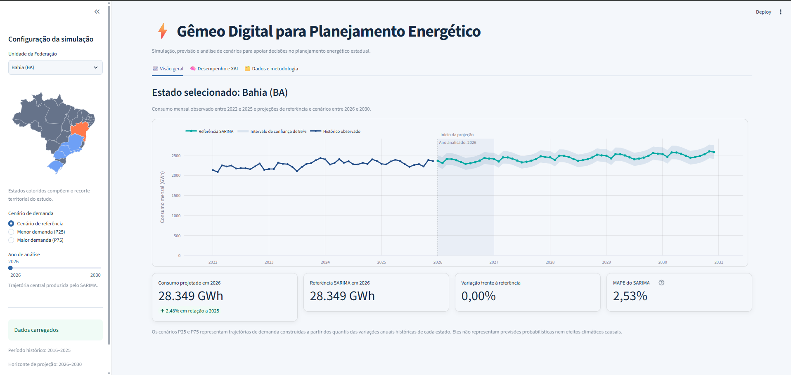
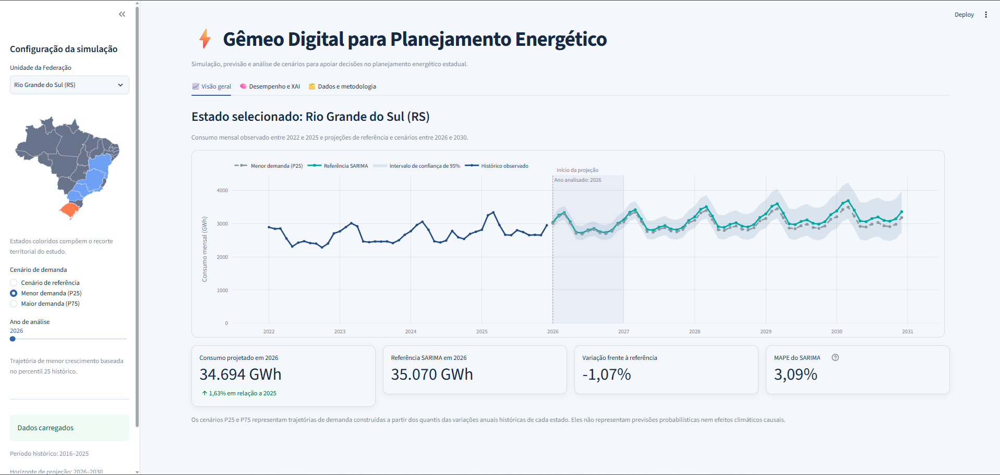
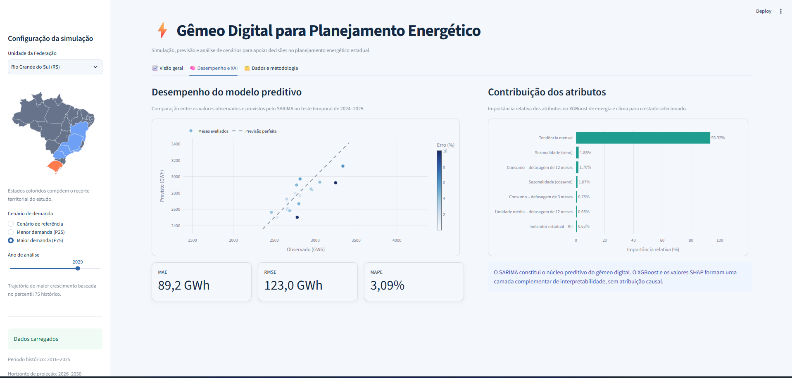
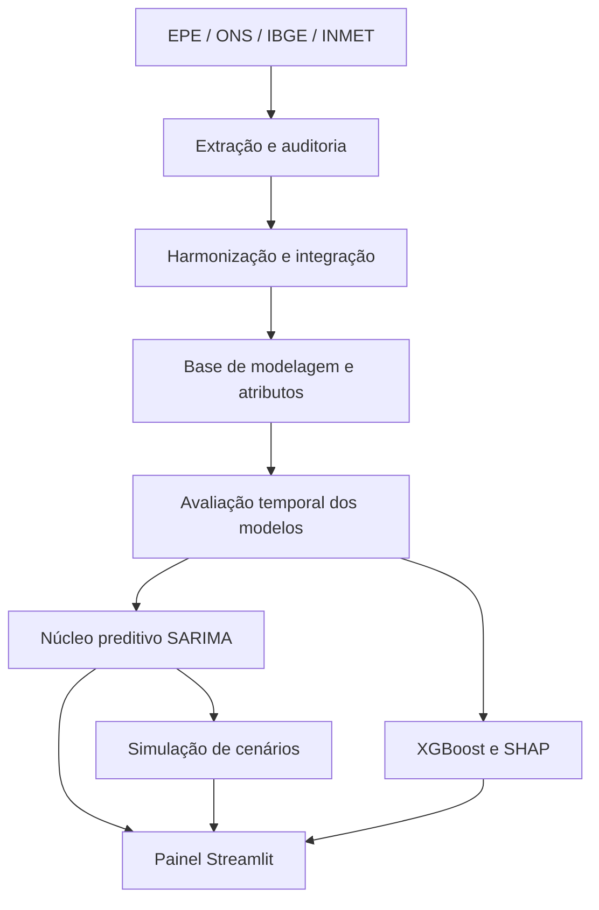
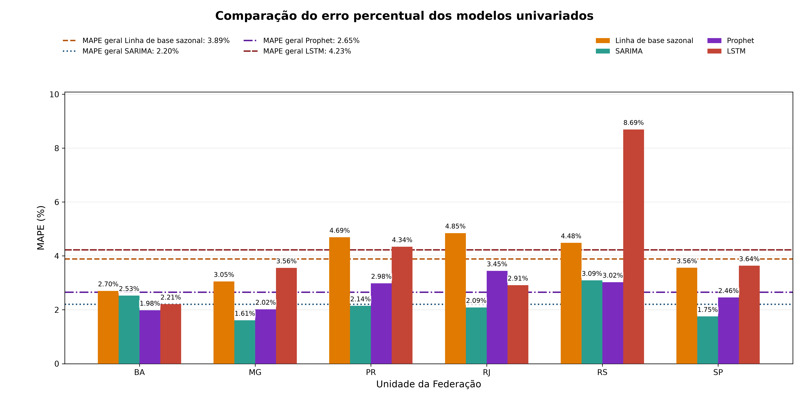
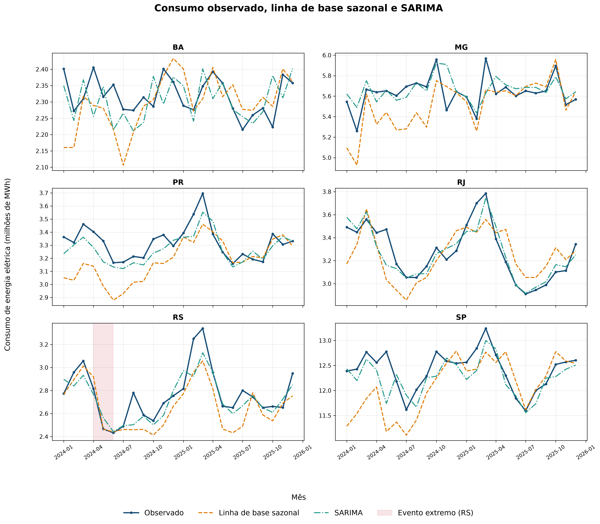
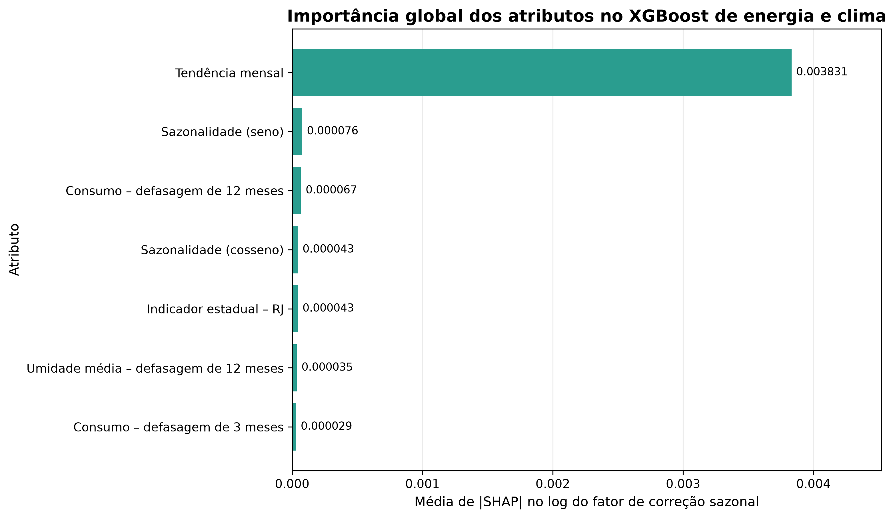
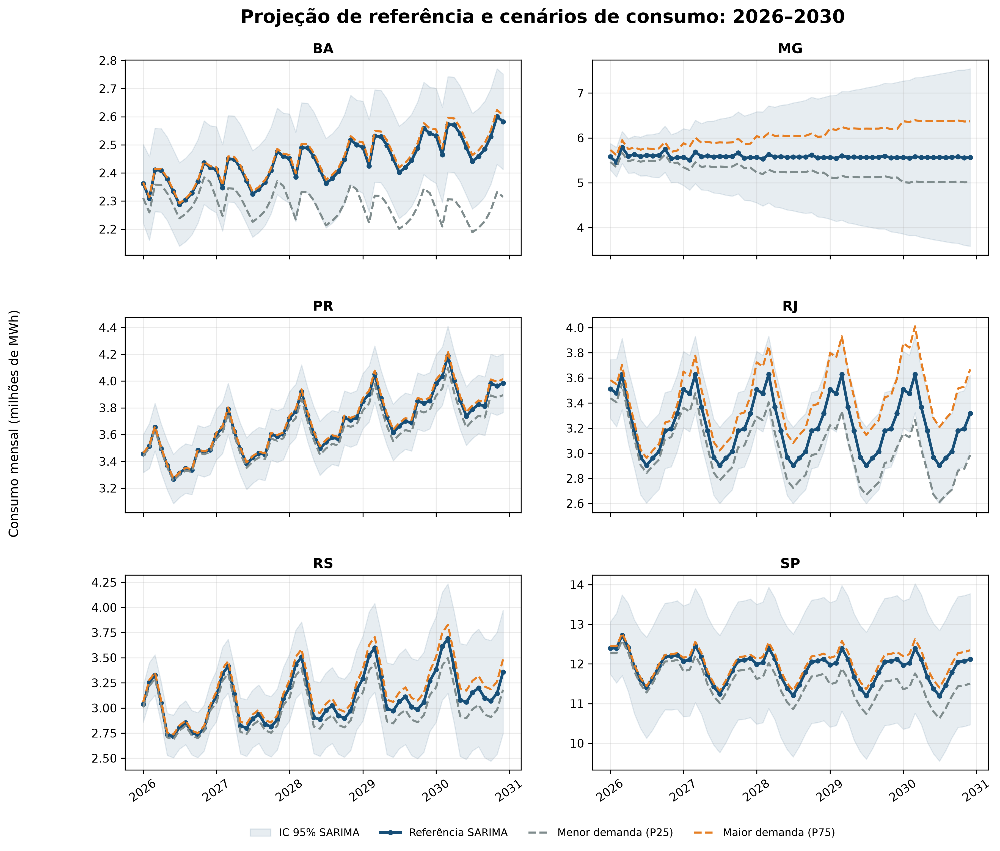

# Gêmeo Digital para Planejamento Energético

**Previsão do consumo de energia elétrica e análise de cenários para estados brasileiros.**

[English](README.md)

  

O planejamento energético exige mais do que previsões precisas. É necessário compreender os padrões regionais de consumo, avaliar trajetórias alternativas de demanda e reconhecer as limitações dos modelos preditivos.

Este projeto integra dados públicos energéticos, socioeconômicos e climáticos em uma estrutura computacional aplicada a seis estados brasileiros. A proposta combina previsão de séries temporais, aprendizado de máquina, inteligência artificial explicável e um painel interativo para apoiar a análise do consumo de energia elétrica até 2030.

Em vez de assumir que algoritmos mais complexos produziriam melhores previsões, o estudo comparou cinco abordagens de modelagem. O SARIMA apresentou o menor erro preditivo global e foi adotado como núcleo preditivo do gêmeo digital.

## Principais resultados

| Indicador | Resultado |
|---|---:|
| Estados brasileiros | 6 |
| Fontes públicas de dados | 4 |
| Abordagens preditivas | 5 |
| Observações de avaliação | 144 |
| MAPE global do SARIMA | **2,20%** |
| Redução relativa do MAPE frente à linha de base sazonal | **43,4%** |
| Horizonte de projeção | 2026–2030 |

## Painel interativo



A aplicação desenvolvida em Streamlit permite selecionar o estado, o cenário de demanda e o ano de análise. São apresentados o consumo histórico, as projeções mensais, o intervalo de 95% do SARIMA e os indicadores anuais.

A interface também apresenta métricas de desempenho, importância dos atributos, rastreabilidade dos dados, premissas metodológicas e opções de exportação dos resultados mensais e anuais.

| Análise de cenários | Desempenho e XAI |
|---|---|
|  |  |

Outras telas: [maior demanda](docs/screenshots/03_higher_demand_scenario.png) · [seleção do ano](docs/screenshots/04_interactive_time_horizon.png) · [dados e metodologia](docs/screenshots/06_data_and_methodology.png) · [tema escuro](docs/screenshots/07_dark_mode.png).

## Recorte da pesquisa e dados

O estudo contempla Bahia (BA), Minas Gerais (MG), Paraná (PR), Rio de Janeiro (RJ), Rio Grande do Sul (RS) e São Paulo (SP). O recorte abrange diferentes padrões regionais de consumo e inclui o Rio Grande do Sul, onde os eventos climáticos extremos de 2024 constituem um contexto relevante para examinar a variabilidade do consumo energético.

| Fonte | Informação |
|---|---|
| EPE — Empresa de Pesquisa Energética | Consumo mensal de energia elétrica |
| ONS — Operador Nacional do Sistema Elétrico | Carga de energia |
| IBGE — Instituto Brasileiro de Geografia e Estatística | População e PIB estadual |
| INMET — Instituto Nacional de Meteorologia | Indicadores climáticos |

O consumo de energia elétrica é a variável-alvo da previsão. A carga do ONS e o consumo da EPE são grandezas distintas e não devem ser tratados como equivalentes.

A preparação dos dados contempla auditoria das fontes, harmonização temporal, agregação geográfica, integração e construção de atributos. A base histórica integrada abrange 2015–2025, enquanto a base de atributos para modelagem contempla 2016–2025. A cobertura específica de cada fonte e as observações ausentes devem ser consideradas na interpretação dos dados integrados.

Consulte o [dicionário da base energética](docs/dicionario_base_energetica.md) e os [dados processados](data/processed/) para acessar a documentação e os resultados das auditorias.

## Arquitetura



A arquitetura separa preparação dos dados, modelagem preditiva, simulação de cenários e interpretação. O painel utiliza os artefatos analíticos resultantes, sem retreinar todos os modelos durante a interação.

## Desempenho preditivo

Os modelos foram avaliados no período de 2024–2025, com 24 observações mensais por estado. MAE e RMSE são expressos em MWh; o MAPE é apresentado em percentual.

| Modelo | MAE (MWh) | RMSE (MWh) | MAPE |
|---|---:|---:|---:|
| Linha de base sazonal | 186.860 | 288.806 | 3,89% |
| **SARIMA** | **100.095** | **158.282** | **2,20%** |
| Prophet | 126.373 | 182.909 | 2,65% |
| LSTM | 199.584 | 280.206 | 4,23% |
| XGBoost — histórico | 174.875 | 257.884 | 3,67% |
| XGBoost — energia e clima | 175.040 | 253.948 | 3,67% |
| XGBoost — completo | 174.857 | 255.377 | 3,67% |



O SARIMA apresentou o melhor desempenho global e o menor MAPE em quatro estados. O Prophet obteve os melhores resultados na Bahia e no Rio Grande do Sul. Esses resultados fundamentam a escolha do SARIMA como modelo de referência comum, sem desconsiderar as particularidades regionais.



Resultados detalhados: [modelos univariados](data/processed/modelagem/comparacao_modelos_univariados_metricas_2024_2025.csv) e [configurações XGBoost](data/processed/modelagem/metricas_xgboost_multivariado_2024_2025.csv).

## Inteligência artificial explicável

O XGBoost foi investigado com três grupos de atributos: histórico, energia e clima, e completo. O SHAP constitui uma camada complementar de interpretação das contribuições dos atributos ao modelo XGBoost.



O painel apresenta a importância dos atributos por estado para a configuração de energia e clima. Os valores SHAP explicam o comportamento do XGBoost, não as previsões do SARIMA, e não estabelecem relações causais.

## Simulação de cenários

Os modelos SARIMA estaduais foram reajustados com observações até 2025 para produzir uma projeção de referência de 60 meses. As trajetórias alternativas utilizam percentis das taxas históricas de crescimento anual de 2016–2023.

| Cenário | Interpretação |
|---|---|
| P25 | Trajetória de menor demanda |
| Referência | Projeção SARIMA |
| P75 | Trajetória de maior demanda |

O motor de cenários ajusta a projeção de referência pela diferença entre o percentil histórico selecionado e a mediana, acumulada ao longo do horizonte de projeção.



O intervalo de 95% pertence à projeção SARIMA. P25 e P75 são trajetórias contrafactuais de demanda, não probabilidades de ocorrência ou estimativas de efeitos climáticos causais.

Consulte os [metadados dos cenários](data/processed/cenarios/metadados_cenarios_2026_2030.json).

## Tecnologias

Python · pandas · NumPy · statsmodels · Prophet · TensorFlow/Keras · scikit-learn · XGBoost · SHAP · Matplotlib · Streamlit · Plotly · PowerShell · Git

## Estrutura do repositório

```text
data/                  # Dados de origem, bases processadas e resultados
  processed/
    modelagem/         # Atributos, previsões, métricas e artefatos SHAP
    cenarios/          # Projeções e metadados dos cenários
docs/
  figures/             # Figuras da pesquisa
  screenshots/         # Capturas do painel
  dicionario_base_energetica.md
src/
  data/                # Extração, processamento e integração
  models/              # Construção de atributos, treinamento e avaliação
  digital_twin/        # Motor de cenários e aplicação Streamlit
.streamlit/            # Configuração do painel
requirements.txt
```

## Instalação e execução

Execute os comandos na raiz do repositório após obter uma cópia local. O ambiente local testado utiliza Windows, Python 3.13.5, Streamlit 1.67.0 e Plotly 7.1.0.

```powershell
python -m venv .venv
.\.venv\Scripts\Activate.ps1
python -m pip install -r requirements.txt
python -m pip check
python -m streamlit run src/digital_twin/app.py
```

Acesse `http://localhost:8501` no navegador. A aplicação utiliza os artefatos processados incluídos no repositório. A execução local foi verificada no ambiente de desenvolvimento existente; a instalação a partir de um ambiente limpo ainda não foi validada de forma independente.

## Reprodutibilidade

O repositório preserva scripts e resultados intermediários das principais etapas da pesquisa:

| Etapa | Implementação |
|---|---|
| Preparação das fontes | [`src/data/`](src/data/) |
| Integração da base | [`integrar_base_modelagem.py`](src/data/integrar_base_modelagem.py) |
| Construção dos atributos | [`preparar_features_modelagem.py`](src/models/preparar_features_modelagem.py) |
| Treinamento e avaliação | [`src/models/`](src/models/) |
| Geração de cenários | [`simular_cenarios.py`](src/digital_twin/simular_cenarios.py) |
| Aplicação interativa | [`app.py`](src/digital_twin/app.py) |

A regeneração integral exige os dados originais das fontes, incluindo os arquivos brutos do INMET que não são versionados. A ordem completa de execução, as instruções de aquisição dos dados e a reprodução em ambiente limpo ainda precisam ser validadas. Consulte os provedores originais quanto às condições de reutilização e redistribuição dos dados.

## Limitações e próximos passos

- O recorte geográfico está restrito a seis estados e não representa uma previsão nacional.
- O desempenho dos modelos está condicionado ao período avaliado e aos dados disponíveis.
- As trajetórias dos cenários dependem das premissas de crescimento histórico.
- O SHAP descreve o comportamento do modelo, sem atribuição causal.
- O gêmeo digital é um protótipo acadêmico baseado em dados históricos e artefatos analíticos, não um sistema operacional sincronizado continuamente.

Como trabalhos futuros, destacam-se a atualização dos modelos com novas observações, a ampliação da validação temporal e o aprimoramento da reprodutibilidade do pipeline completo.

## Contexto acadêmico

Desenvolvido no contexto de pesquisa acadêmica em Planejamento Energético e de Recursos na UNESP. O projeto conecta engenharia elétrica, engenharia de dados e modelagem preditiva a uma aplicação prática de apoio à decisão no planejamento energético.
